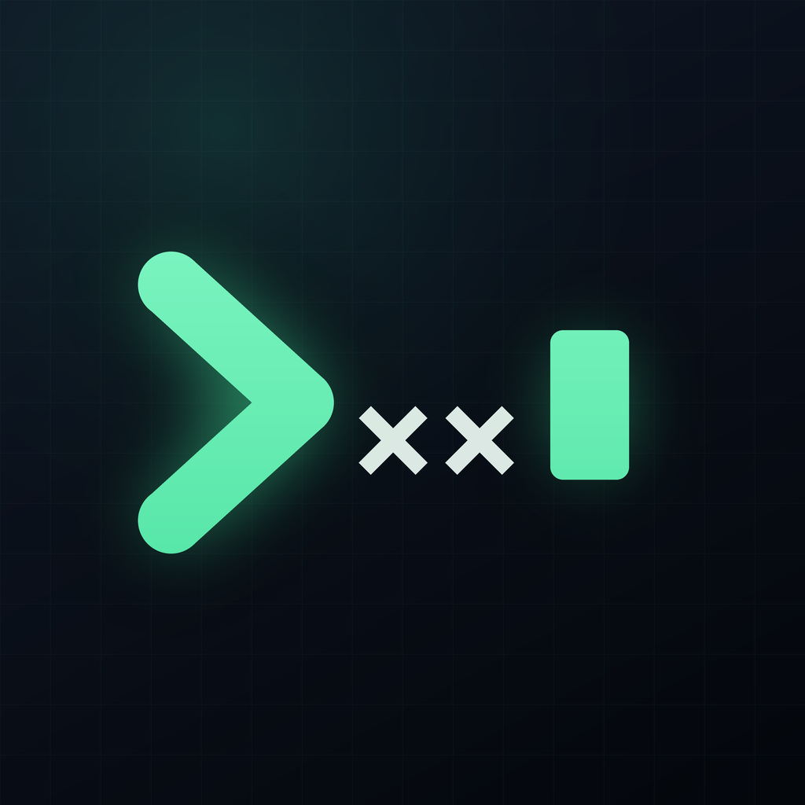

<p align="center"></p>

# Termuxx

Бесплатный SSH- и SFTP-клиент для **iPhone/iPad** и **Arch Linux**. Без рекламы, подписок и телеметрии.

- `Termuxx/` — iOS-приложение (SwiftUI, SwiftTerm, Citadel), Liquid Glass на iOS 26+.
- `linux/` — Termuxx для ПК: терминал с вкладками + менеджер SSH-серверов (GTK4, libadwaita, VTE).

## Установка

Готовые сборки — в [Releases](../../releases/latest):

- **iOS:** `Termuxx.ipa` — неподписанный, подпишите и установите через eSign, Sideloadly, AltStore или TrollStore. iOS 17+, Liquid Glass на iOS 26+.
- **Arch Linux:** `termuxx-git-*.pkg.tar.zst` → `sudo pacman -U termuxx-git-*.pkg.tar.zst`. Или соберите сами: `cd linux/packaging && makepkg -si`.

## Возможности iOS-версии

- **Терминал** (SwiftTerm): xterm-256color, truecolor, шрифты JetBrains Mono и IBM Plex Mono, 6 тем.
- **Вкладки** со стеклянной полосой сессий, разделение экрана на iPad, горячие клавиши (⌘W, ⌘1…9, ⌘⇧[ ], ⌘K, ⌘R, ⌘±).
- **Панель клавиш** над клавиатурой: залипающие Ctrl/Alt, стрелки с автоповтором, настраиваемый набор и порядок.
- **Жесты:** свайп двумя пальцами — стрелки, щипок — размер шрифта.
- **Сессии не теряются:** автопереподключение при возврате в приложение, опция «Работать через tmux», keep-alive.
- **Безопасность:** отпечаток ключа сервера при первом подключении (как known_hosts), Keychain для паролей и ключей, блокировка Face ID.
- **Маршруты:** промежуточный сервер (jump host), SOCKS5-прокси.
- **Ключи:** генерация Ed25519, импорт Ed25519/RSA (в том числе с паролем), установка на сервер в одно касание.
- **SFTP:** потоковая передача с прогрессом, скоростью и отменой, QuickLook, встроенный редактор, поиск и сортировка.
- **Мониторинг сервера:** CPU, память, диски, сеть, процессы с графиками; сервисы systemd и Docker с перезапуском и логами.
- **Проброс портов:** локальные туннели, веб-панели открываются во встроенном Safari.
- **Резервная копия:** экспорт/импорт с шифрованием AES-256-GCM, совместима с Linux-версией ([формат](docs/BACKUP_FORMAT.md)).

## Возможности Linux-версии

Терминал с вкладками (локальные и SSH), список серверов, SFTP-менеджер, мониторинг, туннели, ключи, сниппеты, темы, импорт бэкапа с iPhone. Подробности — в [linux/README.md](linux/README.md).

## Сборка

`.ipa` и пакет для Arch собираются в GitHub Actions при каждом пуше в `main` (iOS — на macOS 26 с Xcode 26). Локально:

```bash
# iOS
brew install xcodegen && xcodegen generate && open Termuxx.xcodeproj

# Arch Linux
cd linux/packaging && makepkg -si
```

Иконка генерируется скриптом `scripts/make_icon.py`.

## Ограничения iOS

iOS приостанавливает приложения в фоне, поэтому через ~30 секунд после сворачивания SSH-соединение может оборваться. Termuxx переподключится сам при возврате, а с опцией tmux вы окажетесь ровно там, где были.

## Лицензия

MIT. Шрифты JetBrains Mono и IBM Plex Mono — SIL Open Font License.
